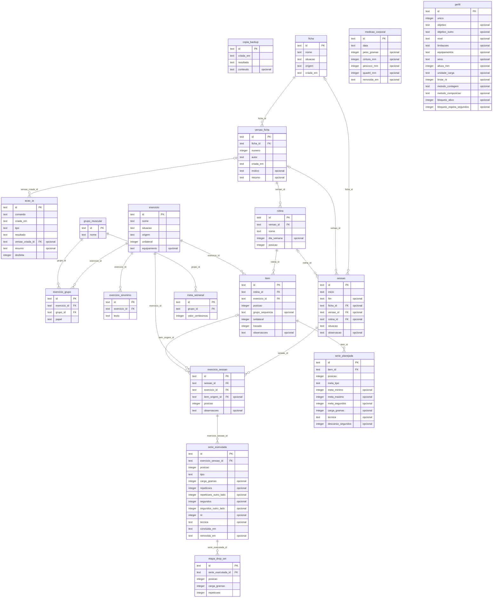

# Modelo de dados

<!-- Gerado por app/scripts/gerar-modelo-de-dados.js a partir do esquema. Não edite à mão:
     rode `npm run modelo-de-dados` em app/ depois de gerar uma migração. -->

Vínculo `||` é obrigatório e `|o` é opcional. PK é a chave primária, FK aponta para outra
tabela e UK é único. Valores calculados (seção 18.6 da especificação) não são guardados.

